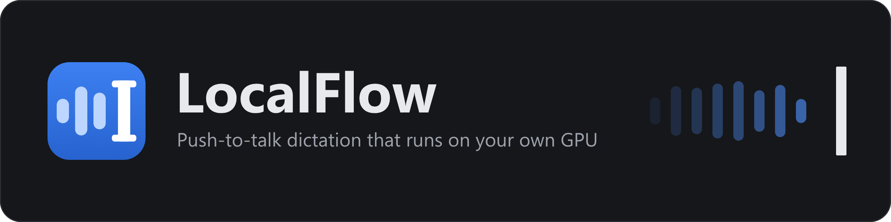
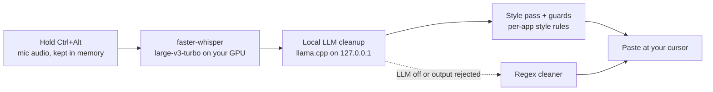

<p align="center">
  
</p>

<p align="center">
  <a href="https://github.com/AverWasTaken/localflow/releases/latest"></a>
  <a href="LICENSE"></a>
  
  
  
</p>

# LocalFlow

**Local push-to-talk dictation for Windows.** Hold Ctrl+Alt, talk, release: clean, punctuated text appears wherever
your cursor is. Speech is transcribed on your own GPU with faster-whisper (large-v3-turbo), tidied up by a small local
LLM running in llama.cpp, and pasted into the app you are using. No cloud, no account, no subscription.

Inspired by Wispr Flow. Not affiliated.

- [Download the latest release](https://github.com/AverWasTaken/localflow/releases/latest)
- [Install](#install) · [Use](#use) · [How it works](#how-it-works) · [Custom-trained model](#custom-trained-model-coming-in-the-next-release) · [Troubleshooting](#troubleshooting) · [Contributing](CONTRIBUTING.md)

## Why LocalFlow

- **Private by design.** Your voice and your text never leave your computer. There is no server to send them to.
- **Fast.** Long dictations are transcribed and cleaned while you are still talking, so text lands a fraction of a
  second after you let go.
- **Writes like you would in each app.** Lowercase texting style in Discord, polished prose in Gmail, literal text in
  your code editor and terminal, all picked automatically from the window you are typing into.
- **Free and open source.** MIT-licensed code, open-weight models, no usage limits.

## Features

- Push-to-talk on Ctrl+Alt (configurable), plus a hands-free lock mode and Esc to cancel.
- Cleanup that removes fillers (um, uh, like, you know), applies spoken self-corrections ("at 3, actually no, 4"
  becomes 4), fixes punctuation and capitalization, handles spoken punctuation ("comma", "new line"), and formats
  dictated lists. It never answers or obeys what you dictate.
- Different writing style per app and per browser tab: lowercase texting style in Discord, polished prose in Gmail,
  literal text in your editor and terminal. Fully editable.
- Streaming transcription: long dictations are transcribed in chunks while you are still talking.
- Custom dictionary (words and replacement rules) and snippets (say a phrase, get a block of text).
- Uses your Windows default microphone and follows it when you change it. Optional per-device override.
- Command mode: hold Ctrl+Win and say an instruction ("make this more formal", "translate to German"). With text
  selected it rewrites the selection, otherwise it writes the answer at the cursor.
- Paste last: Alt+Shift+Z (or tray > Paste last transcript) types your last dictation again.
- Meetings and transcriptions: record a meeting (your mic plus the computer's audio) or transcribe an audio/video
  file, then get a local AI summary, bullet points and action items, or ask questions about it.
- Switch the cleanup model from the tray or Settings: any `.gguf` file you drop into the `models` folder shows up.
- Game mode: frees the GPU while a configured game runs and reloads the models when it closes.
- Home window with your dictation history and stats, plus a tray icon with pause, mic picker and Settings.
- If the LLM is unavailable or produces something off, a deterministic regex cleaner takes over.

## Custom-trained model (coming in the next release)

The current release (v1.1.1) cleans up text with Qwen3.5-4B. The next release adds a cleanup model trained
specifically for LocalFlow: **Liquid AI's LFM3-1.7B, fine-tuned with LoRA** on LocalFlow's cleanup styles and command
mode. The training data is a mix of synthetic examples and a curated set of the author's own dictations. That data is
not published.

On an internal benchmark (test set built by the author, both models quantized to Q8_0, scored as the share of
automated checks passed):

- **Real dictations:** the fine-tuned 1.7B model passed 90% of checks, Qwen3.5-4B 67%. This is the strongest
  evidence, but it is a small sample (61 dictations).
- **Full held-out test** (261 items covering every style plus command mode): 80% vs 60%.
- **Speed:** about 2x faster, roughly 0.3 s vs 0.6 s per cleanup on average, measured on the author's RTX 5060 Ti.
- **Where it is better:** spoken code, short self-corrections ("at 3, no, 4"), leaving dictated questions as
  questions instead of answering them, and long streamed dictations.
- **Where it is still weaker:** command mode (70% vs 82%, mostly code indentation and translations) and a few edge
  cases, such as dictated text that itself contains instructions. A second training round for command mode is in
  progress.

The synthetic test items were written in the same style as the training data, which can flatter the fine-tuned model;
the real-dictation result points the same way. The model's weights are covered by the
[LFM Open License v1.0](https://www.liquid.ai/lfm-license), not by LocalFlow's MIT license.

## Install

1. Download `LocalFlow-Setup-x.y.z.exe` from the [Releases page](https://github.com/AverWasTaken/localflow/releases).
2. Run it. Windows SmartScreen may warn you because the installer isn't code-signed: click **More info**, then
   **Run anyway**.
3. Click through the setup. After copying its files it opens a PowerShell window and downloads everything LocalFlow
   needs: Python, the Python packages, llama.cpp and the AI models (about 7 GB, or about 2.5 GB if you untick the AI
   cleanup model). Windows asks for admin permission once, to add the startup task.
4. When it's done, LocalFlow starts in the system tray. Hold **Ctrl+Alt** and talk.

It installs into `%LOCALAPPDATA%\Programs\LocalFlow` and adds LocalFlow to the Start Menu. If something fails
halfway (no internet, for example), the window shows the error and the full log is in `install.log` in that folder.
Run the setup again and it continues where it stopped. Running a newer setup over an old one upgrades it.

The first launch on a new GPU can take about 30 seconds while CUDA compiles its kernels (cached afterwards).

> [!NOTE]
> The startup task runs LocalFlow with your highest rights at login (as administrator if your Windows account is an
> administrator; a standard account stays standard), so it can type into apps that run as administrator. It runs the
> files in your user folder (`%LOCALAPPDATA%\Programs\LocalFlow`), so anything that can change files in your user
> account could change what runs elevated. If that matters to you, turn off Settings > "Start at login" and start
> LocalFlow from the Start Menu instead.

### Requirements

- Windows 10 or 11, 64-bit.
- An NVIDIA GPU with 6 GB of VRAM or more is recommended (RTX 20-series or newer). The speech model and the cleanup
  model both live on the GPU.
- NVIDIA driver 580 or newer (the bundled llama.cpp build uses CUDA 13). Get it from nvidia.com/drivers.
- About 10 GB of free disk: roughly 3 GB for the Python environment, 4.5 GB for the cleanup model, 1.6 GB for the
  speech model, 0.6 GB for llama.cpp.
- A microphone and an internet connection during setup. After that everything runs offline.

No NVIDIA GPU? It still runs on the CPU, slower and without the AI cleanup. See [Running without a GPU](#running-without-a-gpu).

### Advanced: install from source

```powershell
git clone https://github.com/AverWasTaken/localflow
cd localflow
powershell -ExecutionPolicy Bypass -File install.ps1
```

`install.ps1` is the same script the setup program runs. It checks your system, downloads a pinned copy of
[uv](https://docs.astral.sh/uv/) (which fetches Python 3.12 into the `python` folder), creates `.venv`, installs the
dependencies, downloads the llama.cpp CUDA build, the Qwen3.5-4B Q8_0 model (from Hugging Face) and the Whisper
model, then registers a Task Scheduler task called `LocalFlow` and starts it. Downloads from GitHub are checked
against pinned SHA-256 hashes. Re-running it repairs a broken install. Flags: `-SkipModel` (no cleanup model),
`-NoTask` (no startup task, no admin prompt), `-NoStart` (don't launch at the end). Everything is logged to
`install.log`.

There is one `LocalFlow` startup task per computer (the task name is shared by all Windows users). If it already runs
another copy of LocalFlow, the scripts leave it alone and tell you; use `scripts\register-task.ps1 -Force` to point it
at this copy.

The task runs at logon as you, with the highest run level so LocalFlow can type into elevated windows without a UAC
prompt. It restarts itself on failure. Toggle it from Settings > "Start at login". To run it by hand instead:
`.venv\Scripts\pythonw.exe -m localflow`.

To build the setup program yourself: install [Inno Setup 6.7 or newer](https://jrsoftware.org/isinfo.php)
(`winget install -e --id JRSoftware.InnoSetup`), then run `powershell -ExecutionPolicy Bypass -File installer\build.ps1`.
The result is `dist\LocalFlow-Setup-<version>.exe`. Pushing a `v<version>` tag builds it on GitHub Actions and
attaches it to the release (`.github/workflows/release.yml`).

### Running without a GPU

If `nvidia-smi` is missing the installer says so and carries on. At startup LocalFlow notices there is no CUDA
device and loads `small.en` on the CPU (int8) instead of large-v3-turbo. The installer also writes a config with AI
cleanup turned off, because a 4B LLM on a CPU is too slow to be useful; the regex cleaner handles fillers and
punctuation instead. You can switch cleanup on from the tray menu and see how it feels on your machine. If the
llama.cpp server cannot start for any reason, dictation keeps working with the regex cleaner and the server is retried
at most once a minute.

## Use

| Action | Keys |
|---|---|
| Dictate (push-to-talk) | Hold **Ctrl+Alt** (either side), speak, release |
| Hands-free | While holding Ctrl+Alt, tap **Space**, let go and keep talking. Press Ctrl+Alt again to stop |
| Cancel | **Esc** while recording |
| Command mode | Hold **Ctrl+Win** and say an instruction (rewrites selected text, or writes at the cursor) |
| Paste last transcript | **Alt+Shift+Z** |
| Normal shortcuts | Ctrl+Alt+anything else cancels the recording silently and the key goes through |

Recordings under 0.3 s or silent are dropped. Utterances under 4 words skip the LLM (but still get the style's
deterministic pass). The tray icon (a blue waveform) menu has Settings, History, Pause/Resume, an AI cleanup toggle,
an **Auto style by app** toggle, a microphone picker, Open log and Quit.

Snippets (Settings > Snippets): say the trigger phrase, get the expansion. Dictionary (Settings > Dictionary):
custom words are fed to Whisper as hotwords and to the LLM as preferred spellings; replacement rules fix systematic
mishearings.

### Microphone

By default LocalFlow records from your **Windows default recording device**, the one chosen in Sound settings
(Settings > System > Sound > Input). If you change the default, or unplug and replug a mic, LocalFlow switches over
within a few seconds without a restart. A switch never happens in the middle of a dictation; it waits until you
release the hotkey.

To use a specific mic regardless of the Windows default, pick it from the tray menu > Microphone, or in
Settings > General. For a power-user override you can set `mic.match` in `config.json` to a case-insensitive
substring of the device name (for example `"usb"`); it is used whenever a matching device is present and LocalFlow
falls back to the Windows default when it is not. `mic.device` (an exact name, set by the pickers) wins over
`mic.match`. If a configured mic is unplugged, LocalFlow falls back to the default and switches back when the mic
returns.

## Styles and profiles

LocalFlow looks at the window you are dictating **into** (captured the moment you start holding the hotkey, not when
you let go) and picks a writing style from the process exe name and window title. Browsers put the active tab's
title in the window title (`Inbox (3) - you@gmail.com - Gmail - Google Chrome`,
`Discord | #general | Server - Google Chrome`), so tabs are matched by title regex. The detected style is shown in the
overlay while recording (`casual · Discord`), written to the log
(`recording started: app=chrome.exe style=professional (rule: Gmail) ...`) and stored in the history. Tray >
**Auto style by app** turns the whole thing off (everything is then `neutral`).

| Style | What you get | Used for (default rules) |
|---|---|---|
| `casual` | all lowercase, no final period, minimal punctuation, slang abbreviations for phrases you actually said (idk, nvm, tbh, rn, omw, ngl, imo, btw, omg, brb, idc, ttyl, lmk, fr), apostrophes dropped in unambiguous contractions (dont, cant, im, thats, lets) | Discord (app + web), WhatsApp, Telegram, Messenger, Signal, Instagram / X DMs tabs, Google Messages / iMessage-style web apps, Snapchat web, Reddit chat, Element, Guilded, Skype |
| `professional` | proper capitalization and punctuation, full sentences, grammar fixed, no slang, contractions left as you said them; never adds a greeting, sign-off, name or fact you did not say | Google Docs tab, Word, LinkedIn tabs |
| `email` | `professional` plus email layout: a spoken greeting on its own line, then the body, then a spoken closing (thanks / have a good day) on its own line; short replies stay one line; never adds a greeting or sign-off you did not say. The whole dictation is cleaned in one pass (`whole_cleanup`), so the greeting and closing are handled together | Gmail tab, Outlook (`outlook.exe`, `olk.exe`, Outlook / Office web tabs), Proton / Yahoo mail tabs, Thunderbird |
| `code` | literal wording, first letter not capitalized, no final period on a single sentence | VS Code, Cursor, Windsurf, JetBrains IDEs, Visual Studio, Sublime, Notepad++, Windows Terminal, PowerShell/pwsh, cmd, conhost, Alacritty, WezTerm, mintty |
| `neutral` | normal cleanup (default fallback) | everything else, **Slack and Teams** (work chat) |

Slack and Teams are `neutral` on purpose. To text-chat there, change their rules' `"style"` to `"casual"` (Settings >
Styles, or edit `profiles` in `config.json`).

### Profile rules (`profiles` in config.json)

An ordered list, **first match wins**:

```json
"profiles": [
  {"name": "Discord",       "process": ["discord.exe"], "style": "casual"},
  {"name": "Discord (web)", "process": ["@browsers"], "title": "^\\W*(?:\\(\\d+\\)\\s*)?discord\\s*[|-]", "style": "casual"},
  {"name": "Gmail",         "process": ["@browsers"], "title": "(?:^|[-|]\\s*)Gmail(?:\\s*[-|]|$)", "style": "email"}
]
```

- `process`: exe file names, case-insensitive (`"@browsers"` expands the `process_groups.browsers` list: chrome, msedge,
  firefox, brave, opera, vivaldi, arc, zen, ...). `title`: a regex, case-insensitive, searched anywhere in the window
  title. When both are given **both** must match; at least one is required. A bad regex is ignored (and logged).
- **Add an app**: dictate once in it and read the log line `recording started: app=<exe> ... title='...'` (or look at
  Task Manager > Details), then add `{"name": "My app", "process": ["myapp.exe"], "style": "casual"}` near the top of
  the list. For a website, restrict by title: `{"name": "Notion", "process": ["@browsers"], "title": "\\bNotion\\b",
  "style": "professional"}`. config.json reloads live (every 2 s). **Settings > Styles** edits the same list, has a
  live "which style would this window get?" tester, and an **Add rule for last used app** button that puts a rule for
  the window you last dictated into at the top of the list.
- The old `apps.code` / `apps.chat` lists are still honoured for apps you added to them yourself.

### Styles (`styles` in config.json)

A style is a name plus LLM instructions and deterministic post-processing flags; add your own and point a rule at it:

```json
"styles": {
  "shouty": {
    "description": "ALL CAPS notes",
    "prompt": "Write everything in capital letters. Never add words that were not said.",
    "lowercase": false, "capitalize": true, "strip_trailing_period": false, "abbreviations": false,
    "examples": [["meet at four", "MEET AT 4"]]
  }
}
```

`prompt` goes to the LLM together with the style's few-shot `examples` (spoken -> written); built-in styles have
examples built in (`casual` example: "I don't know, never mind, let's just do it tomorrow." -> "idk nvm lets just do
it tomorrow"). Flags applied in code after the LLM (and also when the LLM is off or skipped for utterances under
`cleanup.min_words`): `lowercase`, `strip_trailing_period` (`true` = always, `"single"` = only a one-sentence text),
`abbreviations` (phrase -> short form using the top-level `abbreviations` map, word-boundary safe, edit it freely),
`drop_apostrophes`, `word_map` (`{"u": "you"}` whole-word fixes for words the model shortens on its own),
`paragraphs` (streamed long dictations only: a pause of `streaming.paragraph_pause_ms` after 3+ sentences starts a
new paragraph), `capitalize` (regex fallback only). The LLM drift guard understands abbreviations (idk is
compared as "I don't know") and rejects invented greetings/sign-offs, chat-style replies and answers.

## Streaming transcription (long dictations)

While you are still talking, a background worker watches the audio with the Silero VAD that ships with
faster-whisper (CPU, ~0.3 ms per 100 ms of audio). When there is a natural pause (`pause_ms`, default 500 ms) after at
least `min_segment_s` (4 s) of speech, that segment is transcribed on the GPU immediately. It never cuts mid-word: it
only cuts in silence, and if you talk for `max_segment_s` (22 s) without a pause it cuts at the quietest point of the
last 2.5 s. Each segment gets the tail of the previous text as Whisper's `initial_prompt` (plus your dictionary
words). On release only the audio after the last cut is transcribed.

Cleanup is incremental too (`incremental_cleanup`): finished sentences are cleaned by the LLM in the background with
the previous cleaned text as read-only context; at release only the last piece is cleaned. A segment that starts with
a self-correction ("actually no, make it 4", "sorry, I mean ...") is merged into the previous piece and that piece is
re-cleaned together, so corrections across a pause still work. A segment that ends mid-sentence (no `.?!`) is held
and cleaned together with the next one. Recordings shorter than `min_record_s` (7 s) never stream, so the common short
dictation takes a single pass. If anything goes wrong the whole recording is simply processed as one pass.

Settings: `streaming.enabled`, `min_segment_s`, `min_record_s`, `pause_ms`, `max_segment_s`, `prompt_chars`,
`incremental_cleanup`, `context_chars`, `paragraph_pause_ms`. Settings > General > "Transcribe while talking" is the
on/off switch.

### Streaming benchmark

Measured on an RTX 5060 Ti with large-v3-turbo + Qwen3.5-4B. The audio is synthetic: Windows SAPI speech with
0.45-1.1 s pauses, fed in real time. These are not recordings of a human talking, so treat them as relative numbers.

Release-to-text in ms (STT + cleanup, no paste), median of 2 runs (90 s clip: 2 runs single / stream_full, 1 run
stream_stt):

| clip | single pass | streaming STT only | streaming STT + incremental cleanup | WER vs script (single -> streaming) |
|---|---|---|---|---|
| 5 s | 410 | 361 | 386 (same single pass, nothing cut) | 0.000 -> 0.000 |
| 20 s | 940 | 822 | **459** | 0.000 -> 0.000 |
| 31 s with 3 spoken corrections across pauses | 1290 | 910 | **52** | 0.049 -> 0.066 (one Whisper name misspelling; all 3 corrections applied) |
| 48 s | 2308 | 1944 | **350** | 0.079 -> 0.024 |
| 95 s | 5214 | 3705 | **346** | 0.038 -> 0.020 |

STT after release drops from 136 / 239 / 464 / 682 / 1614 ms to about 50-100 ms (only the tail). The LLM pass is the
bigger cost for long text (790 / 1611 / 3593 ms of cleanup for 20 / 48 / 95 s single-pass), which is why streaming
without incremental cleanup barely helps and cleanup is done in the background too. Streaming is also more accurate on
anything over about 30 s, because Whisper's long-form decoding drops or garbles words at its 30 s window edges. Worst
case (continuous speech with no pause at all, 38 s): forced lowest-energy cut, 2156 -> 1277 ms, WER 0.134 -> 0.008.
Reproduce with `tests\gen_bench_corpus.py` then `tests\bench_streaming.py`.

## Game mode (free the GPU while gaming)

When a process listed in `game_mode.processes` is running (default `VALORANT-Win64-Shipping.exe`), LocalFlow unloads
the speech model and stops the cleanup llama-server so the VRAM goes back to the game. About 10 s after the game
exits (`exit_grace_s`) both are reloaded, and an overlay toast says so. If the GPU is slow to free up, the reload
retries (5, 10, 20, 40 s) before falling back to the CPU model. Only process names are read; nothing else about other
processes is inspected.

While a game runs, `while_active` decides what dictation does: `"off"` (default) ignores the hotkey (error beep, no
overlay), `"cpu"` keeps dictating on the CPU `small.en` model (4 threads) with regex cleanup instead of the LLM.
Tray: "Game mode (auto)" toggles `game_mode.enabled`; Settings > General > "Game mode" edits all of it. The tray icon
turns teal while game mode is on. Config: `enabled`, `processes`, `poll_s` (3), `exit_grace_s` (10), `while_active`.
Changing `stt.*` settings during a game is applied when the game closes.

## Configuration and data

Everything lives in `%APPDATA%\LocalFlow\`:

- `config.json`: created with defaults on first run. Edits are picked up live (polled every 2 s) and the Settings
  window writes to it.
- `history.db` (SQLite), `localflow.log` (rotating), `llama-server.log`, `crash.log`, `sounds/`.

Key settings: `hotkey` ("ctrl+alt"; any of ctrl/alt/shift/win), `mic.match` and `mic.device` (see
[Microphone](#microphone)), `audio.keep_open` (always-open stream + 400 ms pre-roll), `stt.model/language/device`,
`cleanup.enabled/min_words`, `insert.mode` ("paste" or "type"), `insert.restore_clipboard`, `ui.sounds/overlay`,
`auto_style`, `profiles`, `process_groups`, `styles`, `abbreviations`, `streaming.*`, `dictionary`, `snippets`,
`history.enabled`. The first start after an upgrade writes new sections into your config.json so they are easy to
edit; your own values are kept.

## How it works



1. A low-level keyboard hook notices Ctrl+Alt and starts recording from your microphone. The window you are typing
   into is noted at that moment, which picks the writing style.
2. faster-whisper (large-v3-turbo) turns speech into raw text on the GPU. Long dictations are transcribed in chunks
   while you talk.
3. A small LLM served by llama.cpp on `127.0.0.1` removes fillers, applies corrections and punctuation, and formats
   the text in the chosen style. Guards reject output that drifts from what you said (answers, invented greetings),
   and a regex cleaner takes over when the LLM is off or its output is rejected.
4. The text is pasted through the clipboard (your previous clipboard is restored) or typed key by key.

## Privacy

Everything runs on your machine. Audio is captured into memory, transcribed locally, and discarded; it is not written
to disk. The cleanup LLM is a llama.cpp server bound to `127.0.0.1:8765`, started and stopped by LocalFlow. There is
no telemetry and no account. The only network traffic is the one-time downloads (llama.cpp from GitHub, models from
Hugging Face), which happen at install time or the first time you pick a new model.

Transcripts are kept in a local SQLite history (`%APPDATA%\LocalFlow\history.db`, last 5000 entries) so you can see
and copy past dictations. Turn it off with `"history": {"enabled": false}` or clear it from the History window.
Pasting goes through the clipboard; the previous clipboard contents are restored afterwards
(`insert.restore_clipboard`).

## Troubleshooting

The log is at `%APPDATA%\LocalFlow\localflow.log` (tray > Open log).

- **Nothing happens on Ctrl+Alt**: check the tray icon is present and not paused, then open the log:
  "keyboard hook installed=True" must appear. Some anti-cheat games block low-level hooks.
- **Doesn't paste into an admin window**: LocalFlow must run elevated. Start it via the scheduled task, not a normal
  shell.
- **First start on a new GPU/driver takes ~30 s**: CUDA compiles its kernels once and caches them
  (`CUDA_CACHE_MAXSIZE` is raised to 4 GB so the cache isn't evicted).
- **Speech-to-text is slow (~400 ms+)**: ctranslate2 picked up an old system CUDA 12.x cuBLAS. LocalFlow preloads the
  pip `nvidia-cublas-cu12` 12.9 by path; check the log line "preloaded ...nvidia\cublas".
- **"GPU unavailable - using CPU"**: LocalFlow fell back to small.en int8 on the CPU. Check the log for the CUDA error,
  and that your NVIDIA driver is current.
- **Wrong microphone**: the log prints the chosen device at startup (`microphone: ...`). Change your default in Windows
  Sound settings, use tray > Microphone, or set `mic.match`.
- **Cleanup seems off**: tray > AI cleanup toggles it; `llama-server.log` shows server problems. Port 8765 must be free
  (change `cleanup.port` if not). If the CUDA 13 build won't load on an older driver, update the driver.
- **Alt menu pops up after dictating** (Alt-only hotkeys): LocalFlow injects VK 0xE8 before the Alt key-up to prevent
  it.
- **Wrong style in an app**: dictate once and read `recording started: app=... title=...` in the log, then fix or add a
  rule (Settings > Styles). Tray > Auto style by app turns styles off.
- **Streaming misbehaves**: set `"streaming": {"enabled": false}` to go back to the single pass; the log has `stream:`
  lines for every cut.

Still stuck? [Open an issue](https://github.com/AverWasTaken/localflow/issues/new/choose) with the relevant part of
the log.

## Uninstall

Installed with the setup program: Windows Settings > Apps > Installed apps > LocalFlow > Uninstall (or Start Menu >
LocalFlow > Uninstall LocalFlow). It stops LocalFlow, removes its startup task and deletes the program, Python,
llama.cpp and the cleanup model. It then asks whether to also delete your settings, history, meeting transcripts
and recordings (`%APPDATA%\LocalFlow`) and the downloaded speech models.

Installed from source:

```powershell
powershell -ExecutionPolicy Bypass -File uninstall.ps1          # stop this copy and remove its startup task
powershell -ExecutionPolicy Bypass -File uninstall.ps1 -Purge   # also delete .venv, models, bin, python and %APPDATA%\LocalFlow
```

Then delete the folder. Both only touch the copy they belong to; another LocalFlow copy and its task are left alone.

## Project layout

```
localflow/           package: hotkey.py (WH_KEYBOARD_LL hook), audio.py (+ devwatch.py: default mic lookup), stt.py,
                     cleanup.py (llama-server manager + guards), styles.py (profile rules, style definitions,
                     deterministic style pass), streaming.py (VAD-driven chunked transcription + incremental
                     cleanup), textproc.py, inserter.py (clipboard/SendInput), pipeline.py, overlay.py,
                     settings_ui.py, history_ui.py, app.py (tray + wiring), autostart.py, config.py,
                     winutil.py (foreground window / process detection),
                     gamemode.py (game process watcher)
bin/llama/           llama.cpp b12211 CUDA 13.5 build (llama-server.exe), downloaded by install.ps1
bin/uv/              pinned uv, downloaded by install.ps1; python/ holds the Python it installs
models/              Qwen3.5-4B-Q8_0.gguf, downloaded by install.ps1
scripts/             register-task.ps1 (startup task), stop.ps1, launch.pyw (Start Menu entry), lfcommon.ps1
installer/           LocalFlow.iss (Inno Setup script) and build.ps1 -> dist/LocalFlow-Setup-<version>.exe
tests/               test_unit_*.py (offline), test_cleanup.py, test_e2e.py, bench_streaming.py, gen_bench_corpus.py,
                     test_hotkey_integration.py (drives real keys!), gen_speech.ps1
docs/assets/         logo and README artwork
```

## Roadmap

- **Next release:** ship the custom fine-tuned LFM3-1.7B cleanup model described above, after a second training
  round for command mode.
- Ideas and bug reports are welcome in [issues](https://github.com/AverWasTaken/localflow/issues).

See [CHANGELOG.md](CHANGELOG.md) for what changed in each release.

## Contributing

Contributions are welcome. [CONTRIBUTING.md](CONTRIBUTING.md) covers the dev setup and running the tests. Please
follow the [Code of Conduct](CODE_OF_CONDUCT.md), and report security problems privately as described in
[SECURITY.md](SECURITY.md).

## License

LocalFlow's code is released under the [MIT License](LICENSE).

The AI models are not part of this repository. They are downloaded at install time (or when you pick one) and keep
their own licenses:

| Model | Used for | License |
|---|---|---|
| [Whisper large-v3-turbo](https://huggingface.co/openai/whisper-large-v3-turbo) ([faster-whisper conversion](https://huggingface.co/h2oai/faster-whisper-large-v3-turbo)) | speech-to-text on the GPU | MIT |
| [Whisper small.en](https://huggingface.co/Systran/faster-whisper-small.en) | speech-to-text on the CPU fallback | MIT |
| [Qwen3.5-4B](https://huggingface.co/Qwen/Qwen3.5-4B) ([GGUF](https://huggingface.co/unsloth/Qwen3.5-4B-GGUF)) | text cleanup (current release) | Apache 2.0 |
| [LFM3-1.7B](https://huggingface.co/LiquidAI/LFM3-1.7B), fine-tuned for LocalFlow | text cleanup (next release) | [LFM Open License v1.0](https://www.liquid.ai/lfm-license) |

Python dependencies and llama.cpp keep their own licenses as well.

## Acknowledgements

- [faster-whisper](https://github.com/SYSTRAN/faster-whisper) and OpenAI's [Whisper](https://github.com/openai/whisper)
  for speech recognition, including the Silero VAD that ships with faster-whisper.
- [llama.cpp](https://github.com/ggml-org/llama.cpp) for running the cleanup model locally.
- [Qwen](https://huggingface.co/Qwen) and [Liquid AI](https://www.liquid.ai) for the open language models.
- [uv](https://github.com/astral-sh/uv) for the Python setup, [PySide6](https://doc.qt.io/qtforpython-6/) for the UI,
  and [Inno Setup](https://jrsoftware.org/isinfo.php) for the installer.
- Inspired by Wispr Flow. Not affiliated.
